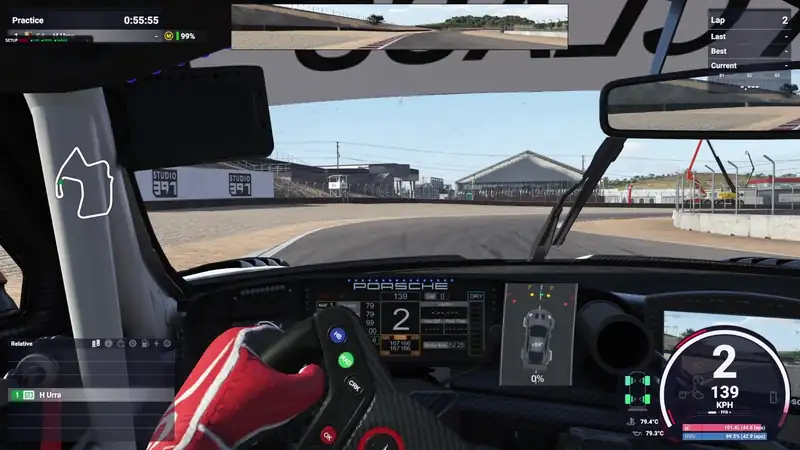

# Huriz - Sim Car Oversteer

*Formerly / antes: **Huriz - LMU Oversteer** and **LMU - Rear Slip Pro***

**Latest version / Última versión: [v0.6.7](../../releases/latest)**

[English](#english) | [Español](#español) · [Changelog](CHANGELOG.md)

---

## English

A **SimHub plugin for sim racing** (**Le Mans Ultimate**, **iRacing**, **rFactor 2** and, in beta, **Automobilista 2** and **RaceRoom**) that makes your **bass shakers**, your **haptic pedals** and your
**Simucube ActivePedal** vibrate when the rear wheels lose grip (rear-end slides). It works with **ShakeIt Bass
Shakers** and with the pedals set up in SimHub Devices (for example Simagic or Simnet haptic pedals, Simsonn VAM or Simucube Active Pedals).

> **Version 0.6.7**, with no time limit. Feedback and bug reports are welcome in the *Issues* tab.

▶ [Watch the full video on YouTube](https://www.youtube.com/watch?v=uv7yqTYdOnI) (1:46, Le Mans Ultimate with v0.5.3)

### In short

- **What it is:** a SimHub plugin that makes your bass shakers, haptic pedals or Simucube ActivePedal vibrate when the rear of the car starts to slide in Le Mans Ultimate, iRacing, rFactor 2, Automobilista 2 (beta) or RaceRoom (beta).
- **Install:** download the installer, close SimHub, run it and choose what to install. It creates the effect for bass shakers (ShakeIt), haptic pedals and Simucube ActivePedal, whichever you use, in **all** your SimHub profiles.
- **It learns your car:** in iRacing, Automobilista 2 and RaceRoom it learns by itself, while you drive slowly, the distance from the centre of gravity to the rear axle (or you can type it). See [Rear-axle distance](#rear-axle-distance-iracing-raceroom-and-automobilista-2).
- **One control per SimHub profile:** each profile has its own on/off, priority and frequency in a table inside the plugin (see [Profiles](#profiles)).
- **Overlay:** the installer also adds an overlay to Dash Studio (Overlays tab) that shows the live view over the game and combines with any other overlay.
- **Two settings are enough:** **Slip Start** (when it starts) and **Slip Max** (when it reaches 100%). **Pro** mode adds curve, anticipation, suspension, throttle limit and smoothing.
- **Everything from one tab:** turn the bass shakers, the haptic pedals, the Simucube ActivePedal and the overlay on or off, and set their frequencies, without going into ShakeIt or Devices.
- **One setup per car:** save and load named setups with one click.
- **Everything explained below:** see the [Settings guide](#settings-guide).

**Contents:** [How it works](#how-it-works) · [Installation](#installation) · [Rear-axle distance](#rear-axle-distance-iracing-raceroom-and-automobilista-2) · [Profiles](#profiles) · [Settings guide](#settings-guide) ·
[Tuning tips](#tuning-tips) · [Troubleshooting](#troubleshooting) · [For advanced users](#for-advanced-users)

### How it works

The plugin reads the telemetry of the two **rear tyres** from the game and measures their **slip angle**:
how many degrees each tyre is moving sideways compared with the direction it points. (Some games do not give the slip
of each tyre; for those the plugin calculates it, see [Games](#games).)

1. While the car grips, the slip is small and nothing happens.
2. When **both** rear tyres slide past **Slip Start**, the effect switches on at a low level.
3. The more the rear slides, the stronger it gets, reaching 100% at **Slip Max**.
4. The result is the vibration of the **rear axle**, which drives your bass shakers and your pedals.
   **One body shaker is enough.**

Built-in protections: it stays off below 15 km/h (adjustable with **Speed Start**) and it switches off if the
telemetry refresh is too slow. Spinning the rear wheels under power is not muted: if the rear slides, it vibrates, with or without throttle.

### Games

- **Le Mans Ultimate** – the plugin was made for it and it is the most tested game. It reads each rear tyre.
- **rFactor 2** – works like Le Mans Ultimate (it reads each rear tyre). It needs the rFactor 2 shared memory plugin
  turned on, as SimHub asks.
- **iRacing** – detected automatically. iRacing does not give the slip of each tyre, so the rear slip is calculated from
  the car speed and its yaw rate, using the distance from the centre of gravity to the rear axle, which the plugin learns for each
  car (see [Rear-axle distance](#rear-axle-distance-iracing-raceroom-and-automobilista-2)).
- **Automobilista 2 (beta)** – same method as iRacing. In the game, turn on the shared memory option. Still in testing.
- **RaceRoom (beta)** – same method as iRacing. Still in testing.
- Other games are not supported. If you want to help with one, turn on the diagnostics switch: it saves the telemetry
  numbers of the game that is running (no personal data); **Open the diagnostics** shows the file.

### What it does

- Detects slip on both rear wheels, with anticipation.
- Limits the effect by throttle and boosts it with suspension bounce.
- Settings tab with a **Simple** mode and a **Pro** mode, a **live view**, and **named setups per car**.
- **Bass shakers**, **Simagic Haptic Pedals**, **Simnet Haptic Pedals**, **Simsonn VAM** and **Simucube ActivePedal** drop-downs with an **on/off switch**, the
  **frequency range** (one bar with two handles) and a **live graph** of the vibration. The switch and the frequencies
  are applied directly in SimHub.
- **A table of your SimHub profiles** in each drop-down: every profile has its own on/off, priority and frequency,
  and a click on its name loads it in SimHub.
- **Samples tab:** the distance from the centre of gravity to the rear axle that iRacing, Automobilista 2 and RaceRoom need,
  learned for each car (or typed by hand).
- **Colour zones** under the main bars (green recommended, yellow with care, red not recommended) and a tick at the default value.
- A **live view** with a GT car seen from above: its front wheels turn with your steering, and the rear wheels, the
  outline and the slide line change colour with the slide (green, then yellow to red).
- An **overlay for Dash Studio** (Overlays tab) that shows the live view over the game.
- Creates the **Huriz - Sim Car Oversteer** effect for **bass shakers** in ShakeIt (50 Hz base, 60 Hz high, high priority).
- Creates the same effect for **haptic pedals** (Simagic, Simnet and Simsonn VAM), on the throttle pedal (45 Hz base, 50 Hz high).
- Creates the same effect for the **Simucube ActivePedal**, on the throttle pedal (50 Hz base, 75 Hz high).
- The effect goes into **every profile** that your bass shakers and pedals have in SimHub, not only the default one.
- English and Spanish interface.
- **New version notice:** when a newer version is out it shows a banner in its tab and, 30 seconds after SimHub starts, a small window with **Update**, **Later** and **Skip this one** (never while a game is running). **Update** downloads it and installs it by itself when you close SimHub (Windows asks for permission once), then opens SimHub again with the same options as last time; if something fails, `install-error.log` opens. It checks GitHub at most once a day and sends no data; without internet it does nothing.

### Requirements

- Windows 10 or 11.
- SimHub with your **bass shakers** (ShakeIt: sound card and shakers) and/or your **pedals** (haptic pedals or
  Simucube Active Pedals, in Devices) already set up.
- Le Mans Ultimate, iRacing, rFactor 2, Automobilista 2 (beta) or RaceRoom (beta).

### Installation

1. Download `Huriz-Sim-Car-Oversteer-Setup.exe` from the [latest release](../../releases/latest).
2. **Close SimHub** and run the installer (it asks for administrator rights and uses the language of Windows).
3. Choose your SimHub folder (the one that contains `SimHubWPF.exe`).
4. Choose what to install. Each device says whether SimHub has it ("detected" in green, "not detected" in
   red); detected ones come ticked, and you can tick the others anyway:
   - **Plugin** – always installed.
   - **Bass shakers** – the effect in ShakeIt Bass Shakers. Ticked.
   - **Pedals (SimHub Devices)** – four options in the same group:
     - **Simagic Haptic Pedals** – **tested only with Simagic haptic pedals**; other brands have not been tested.
     - **Simnet Haptic Pedals (beta)** – testing in progress.
     - **Simsonn VAM (beta)** – Simsonn VAM / VAM Pro, testing in progress.
     - **Simucube ActivePedal (beta)** – testing in progress. The pedal needs some pressure to feel the vibration.
   - **Dash Studio overlay** – ticked.

   The effect is created in **every profile** that already exists in ShakeIt and in each pedal device (the installer
   never creates a profile), on the throttle pedal only; you can change it later in SimHub (Devices > your pedals >
   Effects). If SimHub doesn't have the device yet, add it in Devices and run the installer again. The installer
   writes what it did in `%LOCALAPPDATA%\HurizOversteer\install.log`; if a step fails, it tells you and opens `install-error.log` (same folder) in Notepad so you can send it.
5. Open SimHub and enable the **Huriz - Sim Car Oversteer** plugin when it asks.
6. You will find the **Huriz - Sim Car Oversteer** effect:
   - **Bass shakers:** in ShakeIt, as a single **Mono** signal. One body shaker is enough. With several shakers, choose
     which ones play it in the channel map of your sound output in ShakeIt.
   - **Haptic pedals** and **Simucube ActivePedal:** in SimHub > Devices > your pedals > Effects (in each profile).

**Updating:** from 0.6.7 on, press **Update** when the plugin tells you about a new version (see below). With an older version, download
the new installer and run it with SimHub closed; your settings and setups are kept.

**Updating from Huriz - LMU Oversteer or LMU - Rear Slip Pro:** just run the new installer. It removes the old plugin and keeps your
settings, setups, effects, SimHub menu position and overlay layouts.

If you have never opened ShakeIt, open it once and run the installer again so it can create the effect.

Windows may show "Windows protected your PC" because the installer is not code-signed.
Click *More info* and then *Run anyway*.

### Overlay (Dash Studio)

The installer adds an overlay called **Huriz - Sim Car Oversteer** to SimHub, so you can see the live view over the game.

1. Open SimHub, go to **Dash Studio** and open the **Overlays** tab.
2. Find **Huriz - Sim Car Oversteer** and add it to your overlay layout, next to any other overlays you already use.
3. Place and size it as you like. SimHub manages its position and size.

In the plugin tab, the **Dash Studio overlay** drop-down has an on/off switch for the image and the
**Overlay background** option (dark or fully transparent). It also tells you whether the template is installed.
The road is in the **Image** group of the settings.

The overlay shows the same drawing as the live view, with a single percentage at the bottom centre: **0% at Slip Start
and 100% at Slip Max**, so you can see at a glance how far into the slide you are.

The plugin draws the overlay as an image only when something changes (up to about 15 times per second while the game
is running); with the car stopped, in the pits or in the menus it does nothing. It only adds one template to SimHub: it never changes your existing overlay layouts.

### Rear-axle distance (iRacing, RaceRoom and Automobilista 2)

iRacing, RaceRoom and Automobilista 2 do not say how much each tyre slides. They give the car speed and how fast it
turns, so the plugin needs to calculate **the distance from the centre of gravity to the rear axle** (in metres) of each
car to work out the slide of the rear axle. Le Mans Ultimate and rFactor 2 give the slip of each tyre and do not need it.

**This is a limitation of the telemetry of those games, not of the plugin**, and it is why these games need samples of
each car to be accurate: **the more good samples a car has, the better the accuracy.** There are **two methods**:

- **Method 1 – samples:** drive and let the plugin learn it. [Watch method 1](https://www.youtube.com/watch?v=m7kkxvNTFSc) (video in Spanish; YouTube can translate the subtitles) · [How it works](#how-the-plugin-learns-it-nothing-to-do-just-drive)
- **Method 2 – the value from the web:** look up the wheelbase and the weight distribution of the car and type them in the
  Samples tab. [Watch method 2](https://www.youtube.com/watch?v=ExlhfUzpVKw) (video in Spanish; YouTube can translate the subtitles) · [How it works](#the-samples-tab)

**How the plugin learns it** (nothing to do, just drive):

- Drive **between 15 and 30 km/h with the wheel turned** (some corners or a few S bends). Readings taken with ABS, traction
  control, wheelspin, hard braking or flat throttle are skipped.
- Each good reading is saved with its speed. The faster the car goes, the shorter the distance comes out, so each reading is
  **corrected for its speed** (from about 1.5 % at 15 km/h to about 13 % at 30 km/h, the same table for every car and game). Odd readings are
  thrown out and the rest are averaged.
- When the car reaches its number of samples (10 by default, up to 50) it is marked **Done** and it stops learning. The value is saved for that car.
- In our tests the learned distance was within about 3 % of the real one.

**The Samples tab** (next to **General**, in the plugin tab) shows one table per game with your cars:

- **Car** – click the name to search the web for its wheelbase and weight distribution.
- **Distance, Average, Clean average, Samples, Done, Value** – what has been learned so far and the value in use.
- **Pencil (Edit)** – type the value yourself, or type the **wheelbase (mm)** and the **front and rear weight (%)**, press the
  calculator and then the disk: distance = wheelbase × front weight (for example 2.31 m × 50 % = 1.155 m). A car set by hand
  is Done and is not learned again.
- **Arrow (Reset)** learns the car again from zero. **X (Delete)** removes it from the list (it comes back, learning from zero, if you drive it again).
  **Refresh** writes what has been learned so far.
- **Learning settings** (closed by default): the speeds are fixed at 15–30 km/h; you can choose 10 to 50 samples per car.
- **Open the file, Export, Import** – the file is `distances\<game>-distances.json` in `%LOCALAPPDATA%\HurizOversteer\`; export and import let you
  keep your cars when you change PC.

### Profiles

SimHub can have several profiles for your bass shakers and for each pedal device (for example one per car or game).
The **Bass shakers**, **haptic pedals** and **Simucube ActivePedal** drop-downs show them in a table
(**Profiles (n) – Loaded: …**):

- One row per profile: **High priority**, **Frequency** (bar with its colour zones), **Active** and a reset arrow that brings back
  the values of the device. A profile with nothing set follows the device.
- The profile SimHub has loaded now is in green. **Click a profile name to load it** in SimHub. If SimHub changes profile by
  itself when you change game or car, the plugin follows.
- What you change in SimHub (frequency, high priority, on/off of the effect) shows up in the table, and what you
  change in the table is written to the effect.
- The **switch at the top** of the card turns the effect on or off for the **loaded profile**, and the live graph shows that profile.
- **Add the effect to new profiles** (button at the bottom of the card): when you create a new profile in SimHub it does not have the effect;
  this copies it into every profile that lacks it, using the one from another profile of the same device.

### Settings guide

Open it from the **Guide** button in the plugin tab.

**The tab, from top to bottom**

- **Loaded profile** (green, on the right of the header) – the setup that is currently loaded. With a narrow window it
  moves to its own line.
- **Game** (blue, next to the loaded profile) – the game SimHub is running right now. It changes on its own when you
  switch games and hides when no game is running.
- **Check for updates** (next to the version) – checks GitHub right away for a newer version and tells you the result.
- **New version strip** (blue, under the title) – appears only when a newer version is out. **Update** downloads it;
  when it is ready, **Close SimHub now** (or close it yourself) installs it and SimHub opens again. If the update fails, **Download**
  opens the release page. **Don't remind me about this version** hides it until the next one.
- **Support strip** (purple, under the title) – a short note that the plugin is free, with a button that opens the PayPal
  link. Close it with the **X**; it comes back after each installation. It is never shown in the game.
- **Simple / Pro** – Simple shows only Slip Start and Slip Max. Pro adds the rest. Switching between them
  never loses your values, because both modes use the same settings.
- **ES / EN** – language of the tab. It follows Windows by default.
- **Guide** – opens this guide in your browser.
- **Live view** – shows what is happening while you drive. It has two cars (a GT seen from above) on the same centre:
  the **light grey car** points where your wheels point (it follows your steering), and the
  **coloured-outline car** is how the car is really going. The coloured car turns the same angle as the grey
  one **plus** whatever it slides extra; that extra, in degrees, is written on the roof. The **front wheels** of both
  cars turn with your steering.
  - **Degree line** – the arc above the car. A **green dot** marks the centre, **yellow dots** your **Slip Start** and
    **red dots** your **Slip Max** (for example 3° and 10°). The slide is drawn on this line and changes colour with it.
  - **Colours** (smooth gradient) – **green** at 80% of Slip Start, **yellow** at Slip Start and **red** at Slip Max.
    The rear wheels, the outline, the degrees and the percentage stay grey below 80% of Slip Start; the slide line
    goes from **blue** at the centre to green at 80% (in a straight line it hardly shows). Each rear wheel uses its own
    slide; the rest uses the rear wheel that slides less, like the effect.
  - **Percentage** (bottom centre) – how far into the slide you are: 0% at Slip Start, 100% at Slip Max.
  - **ABS and TC** – the front axle lights up green with "ABS", and the rear axle with "TC", while they act.
  - **Road** – a curved road behind the cars. It bends the way you turn the wheel and its stripes move with speed.
  - **Expand** – shows only the live view, full size, with a **Close** button (Esc also closes it).

**Simple and Pro settings**

- **Slip Start (°)** – how much the rear tyres must slide sideways before the effect starts.
  Lower = it reacts earlier. Default 3°.
- **Slip Max (°)** – the slip at which the effect reaches 100%. Higher = a longer, more gradual build-up.
  Default 10°.
- **Speed Start** – minimum speed: below it the effect does not switch on (red part of the bar), above it, it
  does (green part). 0–60 km/h. Default 15 km/h.
- **Progression curve** *(Pro)* – the shape between Slip Start and Slip Max. 1 = straight line.
  Below 1 the effect rises fast at first and flattens; above 1 it rises gently first and strongly at the end.
  Default 0.5.
- **Anticipation** *(Pro)* – a small amount of vibration (as % of the maximum) when slip grows quickly,
  just before the effect officially starts. A "heads-up" that the rear is about to go. It can start at 80% of your
  Slip Start (2.4° with 3°). Default 10%; 0% = nothing below Slip Start.
- **Suspension influence** *(Pro)* – extra boost from suspension bounce, up to the percentage you set.
  With 50% and a lot of bounce the output can rise up to x1.5. 0 = no boost. Default 50%.
- **Throttle limit** *(Pro)* – above this throttle the effect switches off, with a short fade of about 5%.
  100% = never. Handy if you don't want it during power oversteer. Default 100%. The bar is green where it works and
  red above the value, where it switches off.
- **Smoothing** *(Pro)* – how fast the vibration rises and falls when slip changes.
  **Fast** follows the car instantly and feels sharper, **Normal** is balanced, **Soft** is slower and rounder
  but a little delayed. It scales the rise and fall times: roughly 12/29 ms (Fast), 24/58 ms (Normal) and
  48/116 ms (Soft).
- **Image** – options that only change the drawing of the live view and the overlay, never the vibration:
  - **Road** – shows or hides the road behind the cars. In both Simple and Pro.
  - **Slide direction** *(Pro)* – inverts which way the coloured-outline car swings. Choose **Inverted** if it
    swings the opposite way to the rear sliding.
  - **Steering direction** *(Pro)* – inverts which way the grey car and the road turn. Choose **Inverted** if
    they turn opposite to your steering wheel.

Under **Slip Start**, **Slip Max** and the frequency bars there are **colour zones**: green recommended, yellow with
care, red not recommended. A small tick marks the default value.

**Drop-downs: Dash Studio overlay, Bass shakers, Simagic Haptic Pedals, Simnet Haptic Pedals, Simsonn VAM and Simucube ActivePedal**

Click the title to open or close each one. Closed, it shows a summary on the right (for example "50–60 Hz"),
and the plugin remembers which ones you left open. **Bass shakers**, **Simagic Haptic Pedals**, **Simnet Haptic
Pedals**, **Simsonn VAM** and **Simucube ActivePedal** only appear when their effect is in SimHub, so you only see what you have.
Each one also has its table of [profiles](#profiles).

- **On/off switch** (right of the title) – turns that output on or off. For bass shakers and pedals it
  turns the effect on or off **directly in SimHub** (ShakeIt and Devices), so you see it there at once.
- **Frequency** (bass shakers and pedals) – one bar with two handles. Left: the frequency when the slide
  starts. Right: the frequency at full slide. The plugin writes them into the effect in SimHub (**Frequency** and
  **High frequency**), so set them here and not in ShakeIt. Defaults: 50–60 Hz for bass shakers, 45–50 Hz for
  haptic pedals (they go from 20 up to 50 Hz) and 50–75 Hz for the Simucube ActivePedal.
- **Live graph** – the vibration the plugin sends over the last 8 seconds, from 0 to 100%. On the right: the
  maximum Hz, the current Hz (while it vibrates) and the minimum Hz. With the switch off it stays flat.
- **High priority** (bass shakers and pedals) – while it vibrates, the effect takes precedence over your other
  SimHub effects so it feels clearer. It is the same "High priority" option of the effect in SimHub: changing it here
  changes it there. On by default.
- **Status line** – green when the plugin found its effect in SimHub.

**Buttons**

- **Reset to defaults** – puts every setting back to the recommended values (it keeps your mode and language).
- **Save settings** – saves the settings now. They are also saved when SimHub closes.
- **Open the diagnostics** (box under the setups) – opens the folder with `diagnostics.txt`, the file to send so the plugin
  can be tuned for a game. It only has telemetry numbers and the car and track names. The switch next to it turns the
  file on (it is **off by default**, so nothing is written until you turn it on).
- **Support the project** (same box, purple) – opens the PayPal link. The plugin is free.

**Setups (per car)**

Save one set of settings for each car and load it with one click.

- Type a name and press **Save**: if the name doesn't exist it is created, if it exists it is overwritten.
- Click a setup in the list to load it. The loaded one turns blue. The list keeps a fixed order: Default first, then alphabetical.
- **Rename** edits the name in the list (Enter confirms, Esc cancels). **Delete** asks you to press twice.
- **Default** holds the recommended values. It can't be edited, renamed or deleted.
- A setup stores the plugin settings only. Shakers, haptic pedals and their volume are set in SimHub (ShakeIt and Devices).

### Tuning tips

1. Start with the defaults (Slip Start 3°, Slip Max 10°) and drive a few laps.
2. Effect starts too late or too early → move **Slip Start**.
3. Hard to feel the build-up (it seems to jump to full) → raise **Slip Max** and set the **curve** closer to 1.
4. Want to feel the very first moment more → lower **Slip Start** a little, or raise **Anticipation**.
5. Too nervous → **Smoothing: Soft**. Too slow → **Smoothing: Fast**.
6. **Bass shakers:** the tone moves from the minimum to the maximum frequency as the effect gets stronger. For a more
   audible build-up, widen the **Frequency** bar in the plugin (for example 45–70 Hz). Below 50 Hz the slide is hard
   to read on most body shakers.
7. **Haptic pedals:** they only go up to 50 Hz, so the bar stops there. To change the strength or add the effect to
   another pedal, go to SimHub > Devices > your pedals > Effects.
8. Watch the **Live view** while you tune: if the car swings but the percentages stay low, lower Slip Start.

### Troubleshooting

- **Something does not work and you don't know why.** Download **Huriz-SimHub-Check.exe** from the [latest release](../../releases/latest)
  and run it (one click, it installs and changes nothing). It checks SimHub, tries the installer steps on a **copy** of your settings
  and opens a report in Notepad (also saved on your Desktop as `Huriz-SimHub-Report.txt`): send it in the *Issues* tab.
- **The effect is not in ShakeIt.** Open ShakeIt once, make sure it has at least one profile, then run the installer again
  with SimHub closed. The installer never creates a second copy if it already exists, and never creates a profile.
  If it still does not appear, open `%LOCALAPPDATA%\HurizOversteer\install.log`: it says what each step did and why it skipped one.
- **I made a new profile in SimHub and it has no effect.** Open the plugin tab, go to the card of that device and press
  **Add the effect to new profiles**.
- **The distance of a car looks wrong** (iRacing, Automobilista 2, RaceRoom). Open the **Samples** tab, press **Reset** on the
  car and drive again between 15 and 30 km/h with the wheel turned, or press the pencil and type the real value
  (wheelbase × front weight).
- **The effect is not on my haptic pedals.** Check that SimHub sees your pedals (Devices), close SimHub and run the
  installer again: the haptic option shows "detected" in green when it finds them.
- **No vibration.** Check that the plugin is enabled in SimHub, that the game is running, and that the switch of that
  output is on in the plugin tab. The live graph and the live view should react when the rear slides. On bass
  shakers, check in the channel map of your sound output in ShakeIt that the effect is ON for your shaker.
- **Bass shakers or Simagic Haptic Pedals don't appear in the plugin tab.** The plugin can't find its effect in SimHub.
  Close SimHub and run the installer again with that option ticked.
- **The frequencies in ShakeIt don't match the plugin.** Set them in the plugin tab: it writes them into the effect.
  If you change them in ShakeIt, the plugin puts its own values back the next time you open its tab.
- **The Simucube ActivePedal vibrates weakly or not at all.** The pedal needs some pressure to feel the vibration. Check
  the strength of the effect in SimHub (Devices > Simucube Active Pedals > Effects) and which pedal it is on: the installer
  puts it on the throttle.
- **The tab says this version expired.** Versions before 0.3.5 stop working on a date. Download the latest release,
  which has no time limit.
- **The haptic pedal keeps vibrating after a slide until you pause the game.** Fixed in 0.3.5: update to the latest release.
- **The car in the live view swings to the wrong side.** Tell us in *Issues*; it is a one-line fix.
- **"Windows protected your PC".** The installer is not code-signed. Click *More info* and *Run anyway*.
- **The overlay is not in Dash Studio.** Close SimHub and run the installer again with the Dash Studio option ticked. The plugin tab says whether the template is installed.
- **The overlay is empty or frozen.** Check that the switch of **Dash Studio overlay** is on in the plugin tab and that the game is running.
- **The installer says SimHub is open.** Close SimHub completely (also from the tray icon) and continue.

### For advanced users

Properties published by the plugin (search "HurizOversteer" in SimHub):

| Property | Meaning |
|---|---|
| `RL`, `RR` | Output of the rear axle effect (0-100), without switch |
| `Shaker.RL`, `Shaker.RR` | Same output for bass shakers: 0 when their switch is off |
| `Haptic.RL`, `Haptic.RR` | Same output for haptic pedals: 0 when their switch is off |
| `ActivePedal.RL`, `ActivePedal.RR` | Same output for the Simucube ActivePedal: 0 when its switch is off |
| `Simnet.RL`, `Simnet.RR` | Same output for the Simnet Haptic Pedals: 0 when their switch is off |
| `Simsonn.RL`, `Simsonn.RR` | Same output for the Simsonn VAM: 0 when their switch is off |
| `Shaker.Frequency`, `Haptic.Frequency`, `ActivePedal.Frequency`, `Simnet.Frequency`, `Simsonn.Frequency` | Frequency (Hz) that matches the current vibration, from the minimum to the maximum |
| `Expiry.DaysLeft` | Days left until this version expires, or -1 if the build has no limit |
| `Debug.Rate` | New telemetry readings per second |
| `Debug.SlipRL/RR` | Slip angle per rear wheel (degrees) |
| `Debug.GateRL/RR` | Effect gate open |
| `Debug.TargetRL/RR` | Intensity before smoothing |
| `Debug.Progress`, `Debug.Rise` | Progress (0-100) and slip growth (degrees/s) |
| `Debug.Steering` | Steering wheel, from -1 to 1 |
| `Debug.ABS`, `Debug.TC` | ABS / traction control acting |
| `Overlay.Image` | Path of the latest overlay image (used by the Dash Studio template) |

The effect created in ShakeIt is a Mono Custom effect (JavaScript) that returns `$prop('HurizOversteerPlugin.Shaker.RL')`
and `$prop('HurizOversteerPlugin.Shaker.RR')` on the rear channels; on the haptic pedals it uses `Haptic.RL` and `Haptic.RR`, and on the Simucube ActivePedal `ActivePedal.RL` and `ActivePedal.RR`.

**Files** (in `%LOCALAPPDATA%\HurizOversteer\`): `diagnostics.txt` (only with the diagnostics switch on: 4 lines per second while a game runs; in iRacing it also
shows revs, gear and the wheelspin estimate), `errors.log` (errors the plugin hit) and the effect search logs (`effects\`). They are
emptied every time SimHub starts. `install.log` (what the installer did) and `distances\<game>-distances.json` (the rear-axle distance of each car, with the readings it was learned from) are kept.

**Games:** the SimHub properties each game is read from are in a small JSON file per game inside the plugin. To override or
add one, drop a `.json` file into `PluginsData\Common\HurizOversteer.Games` in the SimHub folder.

### Uninstall

Use *Settings > Apps* in Windows (close SimHub first). Uninstalling removes everything the plugin added: the effects in
ShakeIt and on the pedals, the plugin settings and setups (also the copies SimHub keeps in its own backup
folder), the backups made by the installer, and the plugin folder in `%LOCALAPPDATA%\HurizOversteer\` (logs and the
learned rear-axle distances: use **Export** in the Samples tab first if you want to keep them). Your other effects are not touched.

### License

Copyright (c) 2026 Huriz. All rights reserved. You may use this software for personal use.
Redistribution and modification are not allowed.

---

## Español

Plugin de SimHub para **simracing** (**Le Mans Ultimate**, **iRacing**, **rFactor 2** y, en beta, **Automobilista 2** y **RaceRoom**) que hace vibrar tus **bass shakers**, tus **pedales hápticos** y tus
**Simucube ActivePedal** cuando las ruedas traseras pierden agarre (sobreviraje, se va el culo). Funciona con **ShakeIt Bass
Shakers** y con los pedales configurados en Dispositivos de SimHub (por ejemplo pedales hápticos Simagic o Simnet, Simsonn VAM o Simucube
Active Pedals).

> **Versión 0.6.7**, sin límite de tiempo. Los comentarios y fallos son bienvenidos en la pestaña *Issues*.

▶ [Ver el vídeo completo en YouTube](https://www.youtube.com/watch?v=uv7yqTYdOnI) (1:46, Le Mans Ultimate con la v0.5.3)

### En resumen

- **Qué es:** un plugin de SimHub que hace vibrar tus bass shakers, tus pedales hápticos o tus Simucube ActivePedal cuando el culo del coche empieza a irse en Le Mans Ultimate, iRacing, rFactor 2, Automobilista 2 (beta) o RaceRoom (beta).
- **Instalar:** descarga el instalador, cierra SimHub, ejecútalo y elige qué instalar. Crea el efecto para bass shakers (ShakeIt), pedales hápticos y Simucube ActivePedal, según lo que uses, en **todos** tus perfiles de SimHub.
- **Aprende tu coche:** en iRacing, Automobilista 2 y RaceRoom aprende solo, mientras conduces despacio, la distancia del centro de gravedad al eje trasero (o puedes escribirla). Mira [Distancia al eje trasero](#distancia-al-eje-trasero-iracing-raceroom-y-automobilista-2).
- **Un control por perfil de SimHub:** cada perfil tiene su propio on/off, prioridad y frecuencia en una tabla dentro del plugin (mira [Perfiles](#perfiles)).
- **Overlay:** el instalador añade también un overlay a Dash Studio (pestaña Overlays) que muestra la vista en vivo sobre el juego y se combina con cualquier otro overlay.
- **Con dos ajustes basta:** **Slip Start** (cuándo empieza) y **Slip Max** (cuándo llega al 100%). El modo **Pro** añade curva, anticipación, suspensión, límite de gas y suavizado.
- **Todo desde una pestaña:** enciende o apaga los bass shakers, los pedales hápticos, los Simucube ActivePedal y el overlay, y ajusta sus frecuencias, sin entrar en ShakeIt ni en Dispositivos.
- **Un setup por coche:** guarda y carga setups con nombre con un clic.
- **Todo explicado más abajo:** mira la [Guía de ajustes](#guía-de-ajustes).

**Contenido:** [Cómo funciona](#cómo-funciona) · [Instalación](#instalación) · [Distancia al eje trasero](#distancia-al-eje-trasero-iracing-raceroom-y-automobilista-2) · [Perfiles](#perfiles) · [Guía de ajustes](#guía-de-ajustes) ·
[Consejos de ajuste](#consejos-de-ajuste) · [Problemas frecuentes](#problemas-frecuentes) · [Para usuarios avanzados](#para-usuarios-avanzados)

### Cómo funciona

El plugin lee del juego la telemetría de los dos **neumáticos traseros** y mide su **ángulo de deslizamiento
(slip)**: cuántos grados se mueve cada neumático hacia un lado respecto a la dirección a la que apunta. (Algunos juegos
no dan el slip de cada neumático; para esos el plugin lo calcula, mira [Juegos](#juegos).)

1. Mientras el coche agarra, el slip es pequeño y no pasa nada.
2. Cuando **los dos** neumáticos traseros pasan de **Slip Start**, el efecto se activa con poca intensidad.
3. Cuanto más se va la zaga, más fuerte se vuelve, hasta el 100% en **Slip Max**.
4. El resultado es la vibración del **tren trasero**, que mueve tus bass shakers y tus pedales.
   **Basta con un body shaker.**

Protecciones incluidas: se mantiene apagado por debajo de 15 km/h (se cambia con **Speed Start**) y se apaga si
el refresco de la telemetría es demasiado lento. El patinazo de las traseras al acelerar no se silencia: si la zaga desliza, vibra, con gas o sin él.

### Juegos

- **Le Mans Ultimate** – el plugin nació para él y es el juego más probado. Lee cada neumático trasero.
- **rFactor 2** – funciona como Le Mans Ultimate (lee cada neumático trasero). Necesita el plugin de memoria compartida de
  rFactor 2 activado, como pide SimHub.
- **iRacing** – se detecta solo. iRacing no da el slip de cada neumático, así que el slip trasero se calcula con la
  velocidad del coche y su giro (yaw), usando la distancia del centro de gravedad al eje trasero, que el plugin aprende para
  cada coche (mira [Distancia al eje trasero](#distancia-al-eje-trasero-iracing-raceroom-y-automobilista-2)).
- **Automobilista 2 (beta)** – el mismo método que iRacing. En el juego hay que activar la opción de memoria compartida. En pruebas.
- **RaceRoom (beta)** – el mismo método que iRacing. En pruebas.
- Otros juegos no están soportados. Si quieres ayudar con uno, enciende el interruptor del diagnóstico: guarda los números de
  telemetría del juego en marcha (sin datos personales); **Abrir el diagnóstico** muestra el archivo.

### Qué hace

- Detecta el deslizamiento de las dos ruedas traseras, con anticipación.
- Limita la vibración según el gas y la refuerza con el bote de la suspensión.
- Pestaña de ajustes con modo **Simple** y modo **Pro**, una **vista en vivo** y **setups con nombre por coche**.
- Desplegables de **bass shakers**, **Simagic Haptic Pedals**, **Simnet Haptic Pedals**, **Simsonn VAM** y **Simucube ActivePedal** con **interruptor on/off**, el
  **rango de frecuencia** (una barra con dos tiradores) y una **gráfica en vivo** de la vibración. El interruptor y las
  frecuencias se aplican directamente en SimHub.
- **Una tabla con tus perfiles de SimHub** en cada desplegable: cada perfil tiene su propio on/off, prioridad y frecuencia,
  y un clic en su nombre lo carga en SimHub.
- **Pestaña Muestras:** la distancia del centro de gravedad al eje trasero que necesitan iRacing, Automobilista 2 y RaceRoom,
  aprendida para cada coche (o escrita a mano).
- **Zonas de color** bajo las barras principales (verde recomendado, amarillo con cuidado, rojo no recomendable) y una raya en el valor por defecto.
- Una **vista en vivo** con un GT visto desde arriba: sus ruedas delanteras giran con el volante, y las ruedas traseras,
  el contorno y la línea del derrape cambian de color con el derrape (verde, y de amarillo a rojo).
- Un **overlay para Dash Studio** (pestaña Overlays) que muestra la vista en vivo sobre el juego.
- Crea solo el efecto **Huriz - Sim Car Oversteer** para **bass shakers** en ShakeIt (50 Hz base, 60 Hz alta, prioridad alta).
- Crea el mismo efecto para **pedales hápticos** (Simagic, Simnet y Simsonn VAM), en el acelerador (45 Hz base, 50 Hz alta).
- Crea el mismo efecto para los **Simucube ActivePedal**, en el acelerador (50 Hz base, 75 Hz alta).
- El efecto va en **todos los perfiles** que tengan tus bass shakers y tus pedales en SimHub, no solo en el de por defecto.
- Interfaz en español e inglés.
- **Aviso de versión nueva:** cuando sale una versión más nueva muestra un aviso en su pestaña y, 30 segundos después de arrancar SimHub, una ventana pequeña con **Actualizar**, **Más tarde** y **No avisar de esta** (nunca con un juego en marcha). **Actualizar** la descarga y la instala sola al cerrar SimHub (Windows pide permiso una vez) y vuelve a abrir SimHub con las mismas opciones de la última vez; si algo falla, se abre `install-error.log`. Mira en GitHub como mucho una vez al día y no envía ningún dato; sin internet no hace nada.

### Requisitos

- Windows 10 u 11.
- SimHub con tus **bass shakers** (ShakeIt: tarjeta de sonido y shakers) y/o tus **pedales** (hápticos o Simucube
  Active Pedals, en Dispositivos) configurados.
- Le Mans Ultimate, iRacing, rFactor 2, Automobilista 2 (beta) o RaceRoom (beta).

### Instalación

1. Descarga `Huriz-Sim-Car-Oversteer-Setup.exe` desde la [última release](../../releases/latest).
2. **Cierra SimHub** y ejecuta el instalador (pide permisos de administrador y usa el idioma de Windows).
3. Elige la carpeta de SimHub (la que contiene `SimHubWPF.exe`).
4. Elige qué instalar. Cada dispositivo indica si SimHub lo tiene ("detectado" en verde, "no detectado" en
   rojo); los detectados salen marcados y los demás se pueden marcar igualmente:
   - **Plugin** – siempre se instala.
   - **Bass shakers** – el efecto en ShakeIt Bass Shakers. Marcado.
   - **Pedales (Dispositivos de SimHub)** – cuatro opciones en el mismo grupo:
     - **Simagic Haptic Pedals** – **solo probado con pedales hápticos Simagic**; otras marcas no se han probado.
     - **Simnet Haptic Pedals (beta)** – en pruebas.
     - **Simsonn VAM (beta)** – Simsonn VAM / VAM Pro, en pruebas.
     - **Simucube ActivePedal (beta)** – en pruebas. El pedal necesita algo de presión para notar la vibración.
   - **Overlay de Dash Studio** – marcado.

   El efecto se crea en **todos los perfiles** que ya existen en ShakeIt y en cada dispositivo de pedales (el instalador
   nunca crea un perfil), solo en el pedal del acelerador; puedes cambiarlo después en SimHub (Dispositivos > tus pedales >
   Efectos). Si SimHub aún no tiene el dispositivo, añádelo en Dispositivos y vuelve a ejecutar el instalador. El instalador
   apunta lo que hizo en `%LOCALAPPDATA%\HurizOversteer\install.log`; si algún paso falla, lo avisa y abre `install-error.log` (misma carpeta) en el Bloc de notas para que lo envíes.
5. Abre SimHub y activa el plugin **Huriz - Sim Car Oversteer** cuando lo pida.
6. Encontrarás el efecto **Huriz - Sim Car Oversteer**:
   - **Bass shakers:** en ShakeIt, como una sola señal **Mono**. Basta con un body shaker. Con varios shakers, elige
     en cuáles suena en el mapa de canales de tu salida de sonido en ShakeIt.
   - **Pedales hápticos** y **Simucube ActivePedal:** en SimHub > Dispositivos > tus pedales > Efectos (en cada perfil).

**Actualizar:** desde la 0.6.7, pulsa **Actualizar** cuando el plugin te avise de una versión nueva (ver más abajo). Con una versión anterior,
descarga el instalador nuevo y ejecútalo con SimHub cerrado; tus ajustes y setups se conservan.

**Si vienes de Huriz - LMU Oversteer o de LMU - Rear Slip Pro:** basta con ejecutar el instalador nuevo. Quita el plugin viejo y conserva tus
ajustes, setups, efectos, posición en el menú de SimHub y diseños de overlays.

Si nunca has abierto ShakeIt, ábrelo una vez y vuelve a ejecutar el instalador para que cree el efecto.

Windows puede mostrar el aviso "Windows protegió su PC", porque el instalador no está firmado.
Pulsa *Más información* y luego *Ejecutar de todas formas*.

### Overlay (Dash Studio)

El instalador añade a SimHub un overlay llamado **Huriz - Sim Car Oversteer**, para ver la vista en vivo sobre el juego.

1. Abre SimHub, entra en **Dash Studio** y abre la pestaña **Overlays**.
2. Busca **Huriz - Sim Car Oversteer** y añádelo a tu diseño de overlays, junto a los demás que ya uses.
3. Colócalo y ajusta el tamaño como quieras. SimHub gestiona su posición y su tamaño.

En la pestaña del plugin, el desplegable **Overlay de Dash Studio** tiene el interruptor de la imagen y la opción
**Fondo del overlay** (oscuro o totalmente transparente). También te dice si la plantilla está instalada.
La carretera está en el grupo **Imagen** de los ajustes.

El overlay muestra el mismo dibujo que la vista en vivo, con un solo porcentaje abajo en el centro: **0% en Slip Start
y 100% en Slip Max**, para ver de un vistazo cuánto se está yendo la zaga.

El plugin dibuja el overlay como una imagen solo cuando algo cambia (hasta unas 15 veces por segundo con el juego en marcha);
con el coche parado, en boxes o en los menús no hace nada. Solo añade una plantilla a SimHub: nunca cambia tus diseños de overlays.

### Distancia al eje trasero (iRacing, RaceRoom y Automobilista 2)

iRacing, RaceRoom y Automobilista 2 no dicen cuánto desliza cada neumático. Dan la velocidad del coche y lo rápido que
gira, así que el plugin necesita calcular **la distancia del centro de gravedad al eje trasero** (en metros) de cada
coche para calcular el deslizamiento del eje trasero. Le Mans Ultimate y rFactor 2 dan el slip de cada neumático y no lo necesitan.

**Es una limitación de la telemetría de esos juegos, no del plugin**, y por eso necesitan muestras de cada coche para ser
precisos: **cuantas más muestras buenas tiene un coche, mejor es la precisión.** Hay **dos métodos**:

- **Método 1 – muestras:** conduce y deja que el plugin la aprenda. [Ver el método 1](https://www.youtube.com/watch?v=m7kkxvNTFSc) (vídeo en español) · [Cómo funciona](#cómo-la-aprende-el-plugin-no-hay-que-hacer-nada-solo-conducir)
- **Método 2 – el valor de la web:** busca la distancia entre ejes y el reparto de peso del coche y escríbelos en la pestaña
  Muestras. [Ver el método 2](https://www.youtube.com/watch?v=ExlhfUzpVKw) (vídeo en español) · [Cómo funciona](#la-pestaña-muestras)

**Cómo la aprende el plugin** (no hay que hacer nada, solo conducir):

- Conduce **entre 15 y 30 km/h con el volante girado** (unas curvas o unas eses). Las lecturas con ABS, control de tracción,
  patinazo, frenada fuerte o gas a fondo se saltan.
- Cada lectura buena se guarda con su velocidad. Cuanto más rápido va el coche, más corta sale la distancia, así que cada
  lectura se **corrige según su velocidad** (de un 1,5 % a 15 km/h a un 13 % a 30 km/h, la misma tabla para todos los coches y juegos). Las
  lecturas raras se descartan y las demás se promedian.
- Cuando el coche llega a su número de muestras (10 por defecto, hasta 50) queda marcado como **Hecho** y deja de aprender. El valor se guarda para ese coche.
- En nuestras pruebas la distancia aprendida quedó a menos de un 3 % de la real.

**La pestaña Muestras** (junto a **General**, en la pestaña del plugin) enseña una tabla por juego con tus coches:

- **Coche** – pulsa el nombre para buscar en internet su distancia entre ejes y su reparto de peso.
- **Distancia, Media, Media limpia, Muestras, Hecho, Valor** – lo aprendido hasta ahora y el valor que se usa.
- **Lápiz (Editar)** – escribe tú el valor, o escribe la **distancia entre ejes (mm)** y el **peso delantero y trasero (%)**, pulsa la
  calculadora y luego el disquete: distancia = distancia entre ejes × peso delantero (por ejemplo 2,31 m × 50 % = 1,155 m).
  Un coche puesto a mano queda Hecho y no se vuelve a aprender.
- **Flecha (Reiniciar)** aprende el coche otra vez desde cero. **X (Borrar)** lo quita de la lista (vuelve, aprendiendo desde cero, si lo conduces otra vez).
  **Actualizar** escribe lo aprendido hasta ahora.
- **Ajustes del aprendizaje** (cerrado de serie): las velocidades están fijas en 15–30 km/h; puedes elegir de 10 a 50 muestras por coche.
- **Abrir el fichero, Exportar, Importar** – el fichero es `distances\<juego>-distances.json` en `%LOCALAPPDATA%\HurizOversteer\`; exportar e importar
  te dejan llevarte tus coches al cambiar de PC.

### Perfiles

SimHub puede tener varios perfiles para tus bass shakers y para cada dispositivo de pedales (por ejemplo uno por coche o juego).
Los desplegables de **Bass shakers**, **pedales hápticos** y **Simucube ActivePedal** los enseñan en una tabla
(**Perfiles (n) – Cargado: …**):

- Una fila por perfil: **Prioridad alta**, **Frecuencia** (barra con sus zonas de color), **Activo** y una flecha de reinicio que devuelve
  los valores del dispositivo. Un perfil sin nada propio sigue al dispositivo.
- El perfil que SimHub tiene cargado ahora sale en verde. **Pulsa el nombre de un perfil para cargarlo** en SimHub. Si SimHub cambia
  de perfil solo al cambiar de juego o de coche, el plugin lo sigue.
- Lo que cambias en SimHub (frecuencia, prioridad alta, on/off del efecto) aparece en la tabla, y lo que cambias en la tabla
  se escribe en el efecto.
- El **interruptor de arriba** de la tarjeta enciende o apaga el efecto del **perfil cargado**, y la gráfica en vivo enseña ese perfil.
- **Añadir el efecto a los perfiles nuevos** (botón abajo de la tarjeta): un perfil nuevo de SimHub no trae el efecto; esto lo copia
  en todos los perfiles que no lo tengan, usando el de otro perfil del mismo dispositivo.

### Guía de ajustes

Ábrela desde el botón **Guía** de la pestaña del plugin.

**La pestaña, de arriba abajo**

- **Perfil cargado** (verde, a la derecha de la cabecera) – el setup que está cargado ahora. Con la ventana estrecha
  baja a su propia línea.
- **Juego** (azul, al lado del perfil cargado) – el juego que SimHub tiene en marcha. Cambia solo al cambiar de juego y
  se oculta cuando no hay ninguno.
- **Buscar actualizaciones** (junto a la versión) – mira en GitHub al momento si hay una versión más nueva y te dice el resultado.
- **Franja de versión nueva** (azul, bajo el título) – solo aparece cuando hay una versión más nueva. **Actualizar** la descarga;
  cuando está lista, **Cerrar SimHub ahora** (o ciérralo tú) la instala y SimHub se vuelve a abrir. Si la actualización falla,
  **Descargar** abre la página de la release. **No avisar de esta versión** la oculta hasta la siguiente.
- **Franja de apoyo** (violeta, bajo el título) – una nota corta de que el plugin es gratis, con un botón que abre el enlace de
  PayPal. Se cierra con la **X** y vuelve a salir tras cada instalación. Nunca se muestra dentro del juego.
- **Simple / Pro** – Simple muestra solo Slip Start y Slip Max. Pro añade el resto. Cambiar de uno a otro
  no pierde tus valores, porque los dos modos usan los mismos ajustes.
- **ES / EN** – idioma de la pestaña. Por defecto sigue el de Windows.
- **Guía** – abre esta guía en el navegador.
- **Vista en vivo** – muestra lo que pasa mientras conduces. Tiene dos coches (un GT visto desde arriba) sobre el
  mismo centro: el **coche gris claro** apunta hacia donde apuntan tus ruedas (sigue el volante) y el
  **coche con contorno de color** es cómo va realmente el coche. El de color gira el mismo ángulo que el gris
  **más** lo que se va de más; ese extra, en grados, sale escrito sobre el techo. Las **ruedas delanteras** de los dos
  coches giran con el volante.
  - **Línea de grados** – el arco sobre el coche. Un **punto verde** marca el centro, los **puntos amarillos** tu
    **Slip Start** y los **rojos** tu **Slip Max** (por ejemplo 3° y 10°). El derrape se pinta sobre esta línea y
    cambia de color con ella.
  - **Colores** (en degradado continuo) – **verde** en el 80% de Slip Start, **amarillo** en Slip Start y **rojo** en
    Slip Max. Las ruedas traseras, el contorno, los grados y el porcentaje se quedan en gris por debajo del 80% de Slip
    Start; la línea del derrape va de **azul** en el centro a verde en el 80% (en recta apenas se ve). Cada rueda trasera
    usa su propio derrape; el resto usa la rueda trasera que menos desliza, como el efecto.
  - **Porcentaje** (abajo en el centro) – cuánto se está yendo la zaga: 0% en Slip Start, 100% en Slip Max.
  - **ABS y TC** – el eje delantero se ilumina en verde con "ABS", y el trasero con "TC", mientras actúan.
  - **Carretera** – una carretera curva detrás de los coches. Se curva hacia donde giras el volante y sus rayas
    avanzan con la velocidad.
  - **Ampliar** – muestra solo la vista en vivo, en grande, con un botón **Cerrar** (Esc también la cierra).

**Ajustes de Simple y Pro**

- **Slip Start (°)** – cuánto tienen que deslizar de lado las ruedas traseras para que empiece el efecto.
  Más bajo = reacciona antes. Por defecto 3°.
- **Slip Max (°)** – el slip con el que el efecto llega al 100%. Más alto = una subida más larga y gradual.
  Por defecto 10°.
- **Speed Start** – velocidad mínima: por debajo el efecto no se activa (parte roja de la barra), por encima sí
  (parte verde). De 0 a 60 km/h. Por defecto 15 km/h.
- **Curva de progresión** *(Pro)* – la forma entre Slip Start y Slip Max. 1 = línea recta.
  Menos de 1: sube rápido al principio y se aplana. Más de 1: sube suave al principio y fuerte al final.
  Por defecto 0,5.
- **Anticipación** *(Pro)* – una pequeña vibración (en % del máximo) cuando el slip crece rápido, justo antes de
  que empiece el efecto. Es un aviso de que la zaga está a punto de irse. Puede empezar al 80% de tu Slip Start
  (2,4° con 3°). Por defecto 10%; con 0% no hay nada por debajo de Slip Start.
- **Influencia de suspensión** *(Pro)* – refuerzo extra por el bote de la suspensión, hasta el porcentaje que
  pongas. Con 50% y mucho bote la salida puede subir hasta x1,5. 0 = sin refuerzo. Por defecto 50%.
- **Límite de gas** *(Pro)* – con más gas que este valor el efecto se apaga, con una transición corta de
  un 5%. 100% = nunca. Útil si no lo quieres durante el sobreviraje por potencia. Por defecto 100%. La barra
  está en verde donde funciona y en rojo por encima del valor, donde se apaga.
- **Suavizado** *(Pro)* – con qué rapidez sube y baja la vibración cuando cambia el slip.
  **Rápido** sigue al coche al instante y es más seco, **Normal** es equilibrado, **Suave** es más lento y
  redondo pero con un pequeño retraso. Escala los tiempos de subida y bajada: aproximadamente 12/29 ms (Rápido),
  24/58 ms (Normal) y 48/116 ms (Suave).
- **Imagen** – opciones que solo cambian el dibujo de la vista en vivo y del overlay, nunca la vibración:
  - **Carretera** – muestra u oculta la carretera que va detrás de los coches. En Simple y en Pro.
  - **Sentido del derrape** *(Pro)* – invierte hacia qué lado gira el coche con contorno de color. Elige **Invertido**
    si gira al lado contrario al que se te va la zaga.
  - **Sentido del volante** *(Pro)* – invierte hacia qué lado giran el coche gris y la carretera. Elige **Invertido**
    si giran al revés que tu volante.

Bajo **Slip Start**, **Slip Max** y las barras de frecuencia hay **zonas de color**: verde recomendado, amarillo con
cuidado, rojo no recomendable. Una rayita marca el valor por defecto.

**Desplegables: Overlay de Dash Studio, Bass shakers, Simagic Haptic Pedals, Simnet Haptic Pedals, Simsonn VAM y Simucube ActivePedal**

Haz clic en el título para abrir o cerrar cada uno. Cerrado muestra un resumen a la derecha (por ejemplo "50–60 Hz"),
y el plugin recuerda cuáles dejaste abiertos. **Bass shakers**, **Simagic Haptic Pedals**, **Simnet Haptic Pedals**, **Simsonn VAM** y
**Simucube ActivePedal** solo aparecen si su efecto está en SimHub, así ves solo lo que tienes. Cada uno lleva también su
tabla de [perfiles](#perfiles).

- **Interruptor on/off** (a la derecha del título) – enciende o apaga esa salida. En bass shakers y pedales
  activa o desactiva el efecto **directamente en SimHub** (ShakeIt y Dispositivos), así que lo ves allí al momento.
- **Frecuencia** (bass shakers y pedales) – una barra con dos tiradores. Izquierda: la frecuencia cuando
  empieza el derrape. Derecha: la frecuencia con el derrape a tope. El plugin las escribe en el efecto de SimHub
  (**Frequency** y **High frequency**), así que ajústalas aquí y no en ShakeIt. Por defecto: 50–60 Hz en bass
  shakers, 45–50 Hz en pedales hápticos (van de 20 a 50 Hz) y 50–75 Hz en Simucube ActivePedal.
- **Gráfica en vivo** – la vibración que manda el plugin en los últimos 8 segundos, de 0 a 100%. A la derecha: los Hz
  máximos, los de ahora (mientras vibra) y los mínimos. Con el interruptor apagado se queda plana.
- **Prioridad alta** (bass shakers y pedales) – mientras vibra, el efecto tiene preferencia sobre los demás
  efectos de SimHub y se nota más claro. Es la misma opción "High priority" del efecto en SimHub: si la cambias aquí,
  cambia allí. Activada por defecto.
- **Línea de estado** – en verde cuando el plugin ha encontrado su efecto en SimHub.

**Botones**

- **Restablecer valores** – devuelve todos los ajustes a los valores recomendados (mantiene tu modo e idioma).
- **Guardar configuración** – guarda los ajustes ya. También se guardan al cerrar SimHub.
- **Abrir el diagnóstico** (recuadro bajo los setups) – abre la carpeta con `diagnostics.txt`, el archivo que hay que mandar para
  ajustar el plugin a un juego. Solo tiene números de telemetría y el nombre del coche y de la pista. El interruptor de al
  lado lo activa (viene **apagado por defecto**: no se escribe nada hasta que lo enciendas).
- **Apoyar el proyecto** (mismo recuadro, violeta) – abre el enlace de PayPal. El plugin es gratis.

**Setups (por coche)**

Guarda un ajuste para cada coche y cárgalo con un clic.

- Escribe un nombre y pulsa **Guardar**: si no existe se crea y si existe se sobrescribe.
- Haz clic en un setup de la lista para cargarlo. El cargado se pone en azul. La lista tiene un orden fijo: Default primero y el resto por orden alfabético.
- **Renombrar** edita el nombre en la propia lista (Intro confirma, Esc cancela). **Borrar** pide pulsar dos veces.
- **Default** tiene los valores recomendados. No se puede editar, renombrar ni borrar.
- Un setup guarda solo los ajustes del plugin. Los shakers, los pedales hápticos y su volumen se ajustan en SimHub (ShakeIt y Dispositivos).

### Consejos de ajuste

1. Empieza con los valores por defecto (Slip Start 3°, Slip Max 10°) y da unas vueltas.
2. El efecto entra demasiado tarde o demasiado pronto → mueve **Slip Start**.
3. Cuesta notar cómo sube (parece que salta a tope) → sube **Slip Max** y acerca la **curva** a 1.
4. Quieres notar más el primer instante → baja un poco **Slip Start** o sube **Anticipación**.
5. Demasiado nervioso → **Suavizado: Suave**. Demasiado lento → **Suavizado: Rápido**.
6. **Bass shakers:** el tono va de la frecuencia mínima a la máxima según se hace más fuerte el efecto. Para una
   subida más audible, abre la barra de **Frecuencia** del plugin (por ejemplo 45–70 Hz). Por debajo de 50 Hz el
   derrape se nota poco en la mayoría de body shakers.
7. **Pedales hápticos:** solo llegan hasta 50 Hz, así que la barra se para ahí. Para cambiar la fuerza o añadir el
   efecto a otro pedal, ve a SimHub > Dispositivos > tus pedales > Efectos.
8. Mira la **Vista en vivo** mientras ajustas: si el coche se mueve pero los porcentajes se quedan bajos, baja Slip Start.

### Problemas frecuentes

- **Algo no va y no sabes por qué.** Descarga **Huriz-SimHub-Check.exe** de la [última release](../../releases/latest) y
  ejecútalo (un clic, no instala ni cambia nada). Revisa SimHub, prueba los pasos del instalador sobre una **copia** de tus ajustes
  y abre un informe en el Bloc de notas (también queda en el Escritorio como `Huriz-SimHub-Report.txt`): envíalo en la pestaña *Issues*.
- **El efecto no está en ShakeIt.** Abre ShakeIt una vez, comprueba que tiene al menos un perfil y vuelve a ejecutar el
  instalador con SimHub cerrado. El instalador nunca crea una segunda copia si ya existe y nunca crea un perfil.
  Si sigue sin salir, abre `%LOCALAPPDATA%\HurizOversteer\install.log`: dice qué hizo cada paso y por qué se saltó alguno.
- **He creado un perfil nuevo en SimHub y no tiene el efecto.** Abre la pestaña del plugin, ve a la tarjeta de ese dispositivo y
  pulsa **Añadir el efecto a los perfiles nuevos**.
- **La distancia de un coche parece mal** (iRacing, Automobilista 2, RaceRoom). Abre la pestaña **Muestras**, pulsa **Reiniciar**
  en el coche y vuelve a conducir entre 15 y 30 km/h con el volante girado, o pulsa el lápiz y escribe el valor real
  (distancia entre ejes × peso delantero).
- **El efecto no está en mis pedales hápticos.** Comprueba que SimHub ve tus pedales (Dispositivos), cierra SimHub y
  vuelve a ejecutar el instalador: la opción de hápticos sale "detectado" en verde cuando los encuentra.
- **No vibra.** Comprueba que el plugin está activado en SimHub, que el juego está en marcha y que el interruptor de
  esa salida está encendido en la pestaña del plugin. La gráfica y la vista en vivo deberían reaccionar cuando la
  zaga se va. En bass shakers, comprueba en el mapa de canales de tu salida de sonido en ShakeIt que el efecto está en ON para tu shaker.
- **Bass shakers o Simagic Haptic Pedals no salen en la pestaña del plugin.** El plugin no encuentra su efecto en SimHub.
  Cierra SimHub y vuelve a ejecutar el instalador con esa casilla marcada.
- **Las frecuencias de ShakeIt no coinciden con las del plugin.** Ajústalas en la pestaña del plugin: las escribe en
  el efecto. Si las cambias en ShakeIt, el plugin vuelve a poner las suyas la próxima vez que abres su pestaña.
- **El Simucube ActivePedal vibra poco o nada.** El pedal necesita algo de presión para notar la vibración. Revisa la fuerza
  del efecto en SimHub (Dispositivos > Simucube Active Pedals > Efectos) y en qué pedal está: el instalador lo pone en el
  acelerador.
- **La pestaña dice que esta versión caducó.** Las versiones anteriores a la 0.3.5 dejan de funcionar en una fecha.
  Descarga la última release, que no tiene límite de tiempo.
- **El pedal háptico sigue vibrando después de un derrape hasta que pausas el juego.** Corregido en la 0.3.5: actualiza a la última release.
- **El coche de la vista en vivo se mueve hacia el lado contrario.** Avísanos en *Issues*; se corrige con una línea.
- **"Windows protegió su PC".** El instalador no está firmado. Pulsa *Más información* y *Ejecutar de todas formas*.
- **El overlay no sale en Dash Studio.** Cierra SimHub y vuelve a ejecutar el instalador con la casilla de Dash Studio marcada. La pestaña del plugin dice si la plantilla está instalada.
- **El overlay sale vacío o congelado.** Comprueba que el interruptor de **Overlay de Dash Studio** está encendido en la pestaña del plugin y que el juego está en marcha.
- **El instalador dice que SimHub está abierto.** Cierra SimHub del todo (también desde el icono de la bandeja).

### Para usuarios avanzados

Propiedades que publica el plugin (busca "HurizOversteer" en SimHub):

| Propiedad | Significado |
|---|---|
| `RL`, `RR` | Salida del efecto del tren trasero (0-100), sin interruptor |
| `Shaker.RL`, `Shaker.RR` | La misma salida para bass shakers: 0 con su interruptor apagado |
| `Haptic.RL`, `Haptic.RR` | La misma salida para pedales hápticos: 0 con su interruptor apagado |
| `ActivePedal.RL`, `ActivePedal.RR` | La misma salida para Simucube ActivePedal: 0 con su interruptor apagado |
| `Simnet.RL`, `Simnet.RR` | La misma salida para Simnet Haptic Pedals: 0 con su interruptor apagado |
| `Simsonn.RL`, `Simsonn.RR` | La misma salida para Simsonn VAM: 0 con su interruptor apagado |
| `Shaker.Frequency`, `Haptic.Frequency`, `ActivePedal.Frequency`, `Simnet.Frequency`, `Simsonn.Frequency` | Frecuencia (Hz) que corresponde a la vibración de ahora, del mínimo al máximo |
| `Expiry.DaysLeft` | Días que quedan hasta que caduque esta versión, o -1 si la versión no tiene límite |
| `Debug.Rate` | Lecturas nuevas de telemetría por segundo |
| `Debug.SlipRL/RR` | Ángulo de slip de cada rueda trasera (grados) |
| `Debug.GateRL/RR` | Puerta del efecto abierta |
| `Debug.TargetRL/RR` | Intensidad antes del suavizado |
| `Debug.Progress`, `Debug.Rise` | Progreso (0-100) y crecimiento del slip (grados/s) |
| `Debug.Steering` | Volante, de -1 a 1 |
| `Debug.ABS`, `Debug.TC` | ABS / control de tracción actuando |
| `Overlay.Image` | Ruta de la última imagen del overlay (la usa la plantilla de Dash Studio) |

El efecto que se crea en ShakeIt es un Custom effect en Mono (JavaScript) que devuelve `$prop('HurizOversteerPlugin.Shaker.RL')`
y `$prop('HurizOversteerPlugin.Shaker.RR')` en los canales traseros; en los pedales hápticos usa `Haptic.RL` y `Haptic.RR`, y en los Simucube ActivePedal `ActivePedal.RL` y `ActivePedal.RR`.

**Archivos** (en `%LOCALAPPDATA%\HurizOversteer\`): `diagnostics.txt` (solo con el interruptor del diagnóstico encendido: 4 líneas por segundo con un juego en marcha; en iRacing
también muestra revoluciones, marcha y la estimación de wheelspin), `errors.log` (errores del plugin) y los registros de
búsqueda de efectos (`effects\`). Se vacían cada vez que arranca SimHub. `install.log` (lo que hizo el instalador) y `distances\<juego>-distances.json` (la distancia al eje trasero de cada coche, con las lecturas con las que se aprendió) se conservan.

**Juegos:** las propiedades de SimHub de las que se lee cada juego están en un pequeño fichero JSON por juego dentro del
plugin. Para sustituir o añadir uno, copia un `.json` en `PluginsData\Common\HurizOversteer.Games` dentro de la carpeta de SimHub.

### Desinstalar

Desde *Configuración > Aplicaciones* de Windows (cierra SimHub antes). Al desinstalar se borra todo lo que añadió el
plugin: los efectos de ShakeIt y de los pedales, los ajustes y setups del plugin (también las copias que
SimHub guarda en su propia carpeta de copias de seguridad), las copias de seguridad del instalador y la carpeta del plugin en
`%LOCALAPPDATA%\HurizOversteer\` (registros y distancias al eje trasero aprendidas: usa **Exportar** en la pestaña Muestras
antes si quieres conservarlas). Tus otros efectos no se tocan.

### Licencia

Copyright (c) 2026 Huriz. Todos los derechos reservados. Puedes usar este software para
uso personal. No se permite redistribuirla ni modificarla.